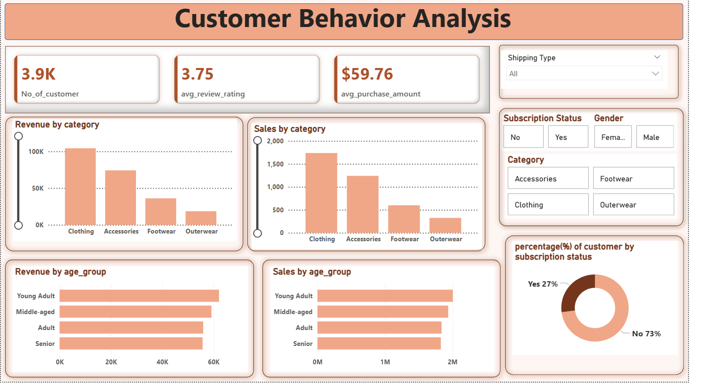

# 🛍️ ShopperPulse: Customer Behavior Analysis

An end-to-end data analytics project that explores customer shopping behavior using **Python (EDA)**, answers business questions with **SQL**, and presents the findings in an interactive **Power BI dashboard**.

---

## Project Overview

The goal of this project is to understand how customers shop: who they are, what they buy, how much they spend, and what drives loyalty and subscriptions. The analysis is done in three stages:

1. **Data cleaning & EDA** using Python, pandas
2. **Business problem solving** with SQL queries
3. **Dashboard** in Power BI for visual, interactive insights

---

## 🗂️ Repository Structure

```
ShopperPulse/
│
├── customer_shopping_behavior.csv      # Raw dataset
├── Customer_behavior_analysis(1).ipynb    # Data cleaning, feature engineering, EDA
├── customer_behavior_queries.sql       # business-problem SQL queries
├── Customer Behavior Dashboard.pbix    # Power BI dashboard file
├── Dashboard.png               # Dashboard screenshot
└── README.md
```

---

## 📊 Dataset

- **Rows:** 3,900 
- **Columns:** 18

| Type | Columns |
|------|---------|
| Customer | `Customer ID`, `Age`, `Gender`, `Location`, `Subscription Status` |
| Product | `Item Purchased`, `Category`, `Size`, `Color`, `Season` |
| Transaction | `Purchase Amount (USD)`, `Payment Method`, `Shipping Type`, `Discount Applied`, `Promo Code Used` |
| Behavior | `Review Rating`, `Previous Purchases`, `Frequency of Purchases` |

---

## Data Cleaning & EDA (Python)

Done in `Customer_behavior_analysis.ipynb` using **pandas**.

- Inspected the data with `head()`, `shape`, `info()`, and `describe()`
- **Handled missing values:** 37 missing values in `Review Rating` were imputed using the **median rating of each product category**
- **Standardized column names** to snake_case (lowercase, underscores) for data consistency and easier use 
- **Feature engineering:**
  - `age_group`: customers split into 4 quartile-based groups (Young Adult, Adult, Middle-aged, Senior) using `pd.qcut`
  - `purchase_frequency_days`: converted text frequency (Weekly, Fortnightly, Monthly, Quarterly, Annually) into the number of days between purchases
- **Removed redundant column:** `promo_code_used` was dropped after verifying it is identical to `discount_applied`
- Cleaned data was then prepared to be loaded into a **PostgreSQL** database (`customer` table) for SQL analysis

---

## Business Problems Solved (SQL)

All queries are in `businessProblemsCustomerBehavior.sql`.

| # | Business Question |
|---|-------------------|
| 1 | What is the total revenue generated by male vs. female customers? |
| 2 | Which customers spent more than the average purchase amount? |
| 3 | Which are the top 5 products with the highest average review rating? |
| 4 | How do average purchase amounts compare between Standard and Express shipping? |
| 5 | Do subscribed customers spend more? (average spend and total revenue) |
| 6 | Which 5 products have the highest percentage of purchases with discounts applied? |
| 7 | Segment customers into New, Returning, and Loyal based on previous purchases |
| 8 | What are the top 3 most purchased products within each category? |
| 9 | Are repeat buyers (more than 5 previous purchases) also likely to subscribe? |
| 10 | What is the revenue contribution of each age group? |

**SQL concepts used:** aggregations, `GROUP BY`, subqueries, CTEs, `CASE WHEN`, window functions (`ROW_NUMBER() OVER (PARTITION BY ...)`), `ORDER BY`, `LIMIT`.

---

## 📈 Power BI Dashboard



**KPIs**
- 👥 **3.9K** customers
- ⭐ **3.75** average review rating
- 💵 **$59.76** average purchase amount

**Visuals**
- Revenue and sales by product category
- Revenue and sales by age group
- Percentage of customers by subscription status

**Interactive filters (slicers):** Shipping Type, Subscription Status, Gender, Category

---

## 🔍 Key Insights

- **Clothing** is the top category in both revenue and sales volume, followed by Accessories, Footwear, and Outerwear.
- **Young Adults** contribute the highest revenue among the age groups, with Middle-aged customers close behind.
- Only about **27%** of customers are subscribed, so there is a clear opportunity to grow subscriptions.
- The average customer spends about **$59.76** per purchase and rates products around **3.75 / 5**.

---

## 🎯 Business Recommendations

1. **Grow the subscription base.** Only 27% of customers are subscribed. Offer free shipping, early access to sales, or exclusive discounts to subscribers, and target repeat buyers first since they are the most likely to convert.
2. **Double down on Clothing and Accessories.** These two categories drive most of the revenue and sales. Prioritize inventory, marketing spend, and seasonal campaigns here.
3. **Fix the low-performing categories.** Footwear and Outerwear lag far behind. Bundle them with Clothing (for example, a jacket with a sweater) and run seasonal promotions, especially for Outerwear in winter.
4. **Focus marketing on Young Adults while retaining other groups.** Young Adults bring the most revenue, but the gap to other age groups is small. Use social-media-driven campaigns for them and loyalty rewards for Middle-aged, Adult, and Senior customers.
5. **Build a loyalty program around customer segments.** Use the New / Returning / Loyal segmentation from the SQL analysis. Welcome offers for new customers, point-based rewards for returning ones, and VIP perks for loyal ones.
6. **Use discounts strategically.** Review which products depend most on discounts (SQL Q6) and avoid discounting items that sell well without them, to protect margins.
7. **Improve review ratings.** The average rating is 3.75 out of 5. Collect feedback on low-rated products (SQL Q3) and fix quality or sizing issues. Follow up with customers who skip leaving a review.
8. **Review shipping options.** Compare average spend across shipping types (SQL Q4) and consider free-shipping thresholds to raise order value.

---

## 🛠️ Tech Stack

| Purpose | Tool |
|---------|------|
| Data cleaning & EDA | Python, pandas, Jupyter Notebook |
| Database & queries | PostgreSQL, SQL |
| Visualization | Power BI |

